<!-- ───────────────────────── 🌙 hero ───────────────────────── -->

  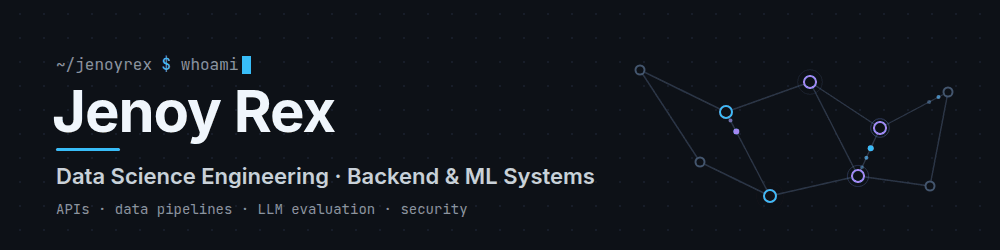

  

  
  
  

<!-- ───────────────────────── 🖥️ about ───────────────────────── -->
<h3 align="center">🖥️ &nbsp;about me</h3>

<table align="center">
<tr>
<td width="72%"></td>
<td width="28%" align="center"></td>
</tr>
</table>

<!-- ───────────────────────── 🌌 projects ───────────────────────── -->
<h3 align="center">🌌 &nbsp;things i've been building</h3>

student projects I made to learn. Some are finished, some aren't. Click a card to open the repo.

<table align="center">
<tr>
<td><a href="https://github.com/Jenoyrex/ctx-receipt"></a></td>
<td><a href="https://github.com/Jenoyrex/vigil"></a></td>
</tr>
<tr>
<td><a href="https://github.com/Jenoyrex/VaultDrop"></a></td>
<td><a href="https://github.com/Jenoyrex/ADPO"></a></td>
</tr>
<tr>
<td><a href="https://github.com/Jenoyrex/multi-agent-cooperation"></a></td>
<td><a href="https://github.com/Jenoyrex/tender-radar"></a></td>
</tr>
<tr>
<td colspan="2" align="center"><a href="https://github.com/Jenoyrex/pata"></a></td>
</tr>
</table>

<b>🔗 &nbsp;live demos (tap to open)</b>

 

| project | try it |
|---|---|
| 🔭 Vigil | [vigiljr.netlify.app](https://vigiljr.netlify.app) |
| 🔐 VaultDrop | [vaultdrop95.netlify.app](https://vaultdrop95.netlify.app) |
| 📊 ADPO | [adpo-gilt.vercel.app](https://adpo-gilt.vercel.app) |
| 🤝 Cooperation Lab | [cooperation-lab.onrender.com](https://cooperation-lab.onrender.com) |
| 📡 tender-radar | [jenoyrex.github.io/tender-radar](https://jenoyrex.github.io/tender-radar/) |
| 🧾 ctx-receipt | `npx ctx-receipt` · [npm](https://www.npmjs.com/package/ctx-receipt) |

The demos run on free tiers, so the first load can take a little while to wake up.

<b>🌙 &nbsp;a quick note</b>

 

I'm a student, and everything here is a learning project. Some of it is unfinished or experimental, and the
READMEs say what works and what doesn't yet. If you see something I could do better, please open an
issue or message me. I'd really appreciate it.

<!-- ───────────────────────── 🛠️ tools ───────────────────────── -->
<h3 align="center">🛠️ &nbsp;tools i'm learning with</h3>


<!-- ───────────────────────── ✨ activity ───────────────────────── -->
<h3 align="center">✨ &nbsp;this year's commits</h3>

  

<!-- ───────────────────────── 🌄 footer ───────────────────────── -->

  

