<p align="center">
  
</p>

<p align="center">
  <a href="https://www.linkedin.com/in/jenoy-rex-0173111b6/"></a>
  <a href="mailto:jenoyrex95@gmail.com"></a>
</p>

<br />


### About Me

```js
const jenoy = {
  role: "Full-Stack Developer · Data Science Engineering Student",
  location: "Karnataka, India",

  building: [
    "Vigil — LLM observability & evaluation platform",
    "VaultDrop — zero-knowledge encrypted file vault",
    "ADPO — deterministic CI intelligence",
    "Pata — Indian address intelligence benchmark",
  ],

  learning: [
    "Data Science & Machine Learning fundamentals",
    "Distributed systems",
  ],

  tech: {
    frontend: ["Next.js", "React", "TypeScript", "Tailwind CSS"],
    backend: ["FastAPI", "Express.js", "Python"],
    data: ["PostgreSQL", "ClickHouse", "SQLAlchemy", "Prisma"],
    devops: ["Docker", "GitHub Actions", "Render", "Vercel", "Netlify"],
  },
};
```

> "The first principle is that you must not fool yourself."
> — Richard Feynman

<br clear="right" />

### Selected Work

**[Vigil](https://github.com/Jenoyrex/vigil)** — LLM observability & evaluation platform
A production-shaped stack for LLM applications: a Python SDK streams trace/span telemetry to a
FastAPI ingestion API backed by ClickHouse, a worker/poller pipeline runs relevance evaluators
(TF-IDF and local embeddings — no third-party model calls) against sampled spans, and a Next.js
dashboard surfaces traces, analytics and results. Real multi-tenant auth, Alembic-migrated
Postgres control plane, full CI/CD to a gated manual deploy, and encrypted off-host backups.
`TypeScript` `Next.js` `Python` `FastAPI` `ClickHouse` `PostgreSQL` `Docker`
[Live demo ↗](https://vigiljr.netlify.app) · [Repository ↗](https://github.com/Jenoyrex/vigil)

**[VaultDrop](https://github.com/Jenoyrex/VaultDrop)** — zero-knowledge encrypted file vault
Files are encrypted client-side (AES-256-GCM via the Web Crypto API) before they ever leave the
browser — the server stores only ciphertext and wrapped keys, never usable key material.
TypeScript monorepo deployed live across Netlify, Render, Neon and Backblaze B2, with CI running
typecheck/test/build on every push.
`TypeScript` `Next.js` `Express` `Prisma` `PostgreSQL`
[Live demo ↗](https://vaultdrop95.netlify.app) · [Repository ↗](https://github.com/Jenoyrex/VaultDrop)

**[ADPO](https://github.com/Jenoyrex/ADPO)** — deterministic CI intelligence
Connects to a repo via a GitHub App and runs six statistics-based analyzers over its Actions
history — no LLM — surfacing slow jobs, dependency-install overhead and retry waste, with every
finding traceable back to real run data.
`Python` `FastAPI` `PostgreSQL` `React`
[Live demo ↗](https://adpo-gilt.vercel.app) · [Repository ↗](https://github.com/Jenoyrex/ADPO)

**[Multi-Agent Cooperation](https://github.com/Jenoyrex/multi-agent-cooperation)** — negotiation
research <sub>*(college group project)*</sub>
A preregistered study testing whether structured negotiation instructions change welfare,
fairness and agreement rates when two LLM agents — one Claude, one GPT — split resources under
hidden valuations, alongside a separate zero-cost sandbox for exploring rule-based negotiations.
The 480-negotiation design, harness and analysis pipeline are built and tested; the real-model
study itself hasn't been run yet, so there are no results to report.
`Python` `SQLite` `Anthropic API` `OpenAI API`
[Live demo ↗](https://cooperation-lab.onrender.com) · [Repository ↗](https://github.com/Jenoyrex/multi-agent-cooperation)

**[Pata](https://github.com/Jenoyrex/pata)** — Indian address intelligence benchmark
An open-source benchmark and toolkit for parsing, normalizing, resolving and geocoding noisy,
multilingual Indian addresses — built process-first, with architecture decision records and an
explicit rule that unknowns are recorded as unknown, never guessed. Pre-alpha: no datasets,
models or benchmark results exist yet; the current milestone is validating the reference
gazetteer itself.
`Python`
[Repository ↗](https://github.com/Jenoyrex/pata)

### Tech Stack

<p align="center">
  
</p>

<p align="center"><code>ALSO</code>&nbsp; ClickHouse · SQLAlchemy · Alembic · SQLite · pytest · Vitest</p>

### GitHub Analytics

<p align="center">    </p>
<p align="center">
  
</p>

<p align="center">
  
</p>

### GitHub Trophies

<p align="center">
  
</p>
